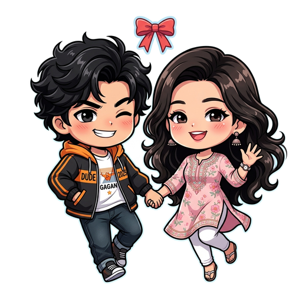
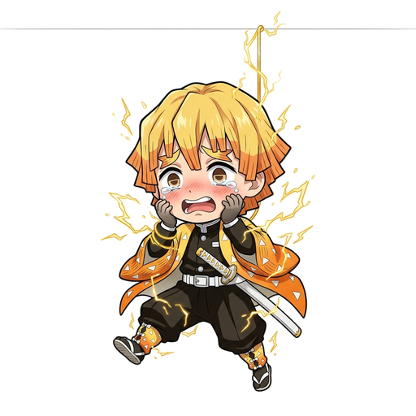
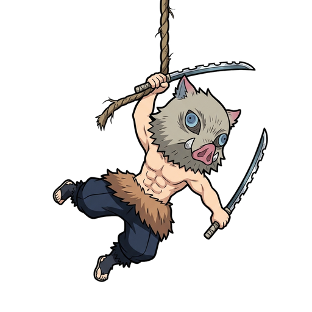
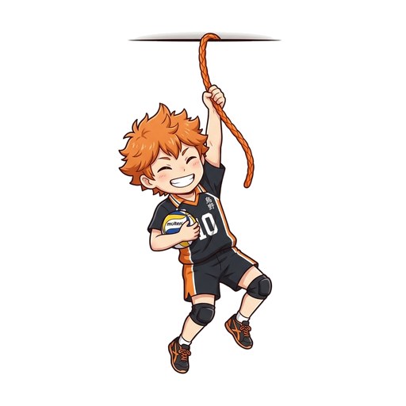

# 🧵 Pop-ups: Anime Desktop Pet & Audio Companion

[](https://opensource.org/licenses/MIT)
[](https://vitejs.dev/)
[](https://react.dev/)
[](https://www.typescriptlang.org/)
[](https://www.ubuntu.com/)

> ### 🌸 Dedicated to Denji & Reze (*Chainsaw Man: Bomb Girl Arc*)
> *"Have you ever been in a pool at night, Denji? Let's run away together..."*
>
> This project was created as an affectionate fan tribute and love letter to **Denji and Reze** from Tatsuki Fujimoto's *Chainsaw Man* — bound together by the red thread of fate, hanging peacefully from your desktop screen while listening to the bittersweet night melody of *"in the pool"*.

An interactive, transparent desktop companion application designed for Linux (GNOME / X11). The companion hangs from the top edge of your desktop screen by a thread, reacts to mouse touches, swings with realistic damped pendulum physics, plays beat-reactive music, and allows you to seamlessly switch characters or upload custom audio.

Features **native click-through pass-through** (using X11 shape masking) so you can work and use other applications normally while your companion hangs on your desktop.

---

## 📸 Companions & Artwork

### 🌸 Romantic Anime & Cinema Duos
| **Reze & Denji** (*Chainsaw Man*) | **Eren & Mikasa** (*Attack on Titan*) | **Gagan & Kundana** (*Dude*) |
|:---:|:---:|:---:|
|  |  |  |
| *Crimson Thread & "In the pool" OST* | *Red Scarf of Fate & Scout Cloak* | *DUDE 2025 Streetwear & Kurti* |

### ⚔️ Demon Slayer (*Kimetsu no Yaiba*)
| **Tanjiro Kamado** | **Nezuko Kamado** | **Zenitsu Agatsuma** | **Inosuke Hashibira** |
|:---:|:---:|:---:|:---:|
|  |  |  |  |
| *Sun Breathing & Haori* | *Bamboo Muzzle & Ribbon* | *Thunder Breathing & Sparks* | *Wild Boar & Dual Serrated Blades* |

### 🏐 Haikyuu!!
| **Shoyo Hinata** (*Karasuno #10*) | **Tobio Kageyama** (*Karasuno #9*) |
|:---:|:---:|
|  |  |
| *The Ultimate Decoy & Volleyball* | *King of the Court & Setter Toss* |

### 🤞 Jujutsu Kaisen
| **Gojo Satoru** | **Ryomen Sukuna** | **Yuji Itadori** |
|:---:|:---:|:---:|
|  |  |  |
| *Six Eyes & Limitless* | *King of Curses & Throne* | *Sukuna Vessel & Golden Wire* |

| **Yuta Okkotsu** | **Megumi Fushiguro** | **Nobara Kugisaki** |
|:---:|:---:|:---:|
|  |  |  |
| *Special Grade & Katana* | *Ten Shadows & Divine Dog* | *Straw Doll & Resonance Hammer* |

Original generated reference artwork is preserved in [`art/`](./art/).

---

## ✨ Core Features

### 1. 🧵 Damped Pendulum Physics
- **Harmonic Oscillation**: Implements continuous damped harmonic physics:
  $$\frac{d^2\theta}{dt^2} = -\frac{g}{L} \sin(\theta) - c \frac{d\theta}{dt}$$
- **Interactive Drag & Fling**: Pull your companion sideways and release to watch natural momentum and settling swings.
- **Top Anchor Relocation**: Drag the top anchor pin anywhere across the screen edge to position your pet wherever you want.
- **Shake Detection**: Vigorously shaking your pet activates a dizzy expression with spinning stars.

### 2. 🪟 Native Desktop Pass-Through Overlay (`desktop_overlay.py`)
- **100% True Transparency**: Built with Python 3, PyGObject (`GTK 3.0`), and WebKit2GTK.
- **Dynamic Input Shape Masking**: Uses Cairo region masking (`input_shape_combine_region`) so clicks outside the pet pass straight through to whatever application or window is underneath.
- **Automatic Modal Interactivity**: Opening Settings or Studio dynamically expands the interactive region so all sliders, buttons, and file dialogs receive input without restriction.

### 3. ⚙️ Double-Tap Settings Popup
- **Instant Double-Click / Double-Tap**: Fast software double-tap detection on the pet opens the settings menu immediately.
- **Full Customization**:
  - Independent toggles for Character visibility and Music playback.
  - Companion Size slider (75% to 165%).
  - Hanging thread length slider (100px to 350px).
  - Volume slider and screen position slider.
  - Quick Switch row to instantly hop between characters.

### 4. 🎵 Music Player & Persistent Custom Audio
- **Built-in Soundtrack**: Chainsaw Man "in the pool" theme and procedural chillhop synth chords.
- **Custom Audio Importer**: Click **Upload Music** to open a native file dialog and select any local audio file (`.mp3`, `.wav`, `.ogg`, `.m4a`, `.flac`).
- **Disk Persistence**: Uploaded songs are saved permanently on disk (`public/custom_track.audio` and `public/custom_track_meta.json`) so your selected song plays continuously across restarts until you choose a new one.

---

## 🚀 Getting Started

### Prerequisites

On Ubuntu / Debian:
```bash
sudo apt update
sudo apt install -y python3 python3-gi python3-gi-cairo gir1.2-gtk-3.0 gir1.2-webkit2-4.1 nodejs npm
```

### Installation (All-in-One)

Clone the repository and install all dependencies (npm packages, Python `requirements.txt`, and build) in one go:
```bash
git clone git@github.com:gnshx/pop-ups.git
cd pop-ups

# Option A: One-go setup script (recommended)
./setup.sh
# or:
npm run setup

# Option B: Manual npm & python install
npm install
pip install -r requirements.txt
npm run build
```

> **Note:** If you launch `./run_high.sh` or `./run_low.sh` right away, it will also automatically detect and download any missing npm dependencies and build the app for you!

### ⚡ Running the 2 Versions

Pop-ups includes two optimized engine profiles tailored for your machine's hardware:

| Feature | ⚡ High-End / Full GPU Version | 🍃 Low-End / Eco Version |
|---|---|---|
| **Target Hardware** | Modern PCs, discrete GPUs (NVIDIA/AMD), high refresh rate screens | Low-end laptops, budget CPUs, integrated Intel/AMD graphics, battery saver |
| **Target FPS** | **60 FPS** unthrottled during action, 24 FPS idle | **8–30 FPS** adaptive (8 FPS idle, 4 FPS sleep) |
| **Canvas Backing Buffer** | **Native Retina Hi-DPI (1.5x–2.0x)** | **Clamped 1.0x DPI** (75% less pixel memory) |
| **Glow & Shadows** | Canvas `shadowBlur` & neon gradients enabled | **Shadows disabled** (eliminates software rasterizer lag) |
| **Particles** | Rich 25-particle physics & continuous notes | Capped to 3 active particles max |
| **Sleep Mode Timer** | 20 seconds inactivity | 10 seconds inactivity (drops to 4 FPS quickly) |
| **CPU Scheduling** | Normal priority | Lower priority (`os.nice(10)`) |

---

#### ⚡ 1. High CPU & GPU Version (Full Visual Fidelity)
For maximum aesthetic quality, crisp Retina supersampling, and 60 FPS:
```bash
./run_high.sh
# or:
./run_desktop.sh --high
```

#### 🍃 2. Low-End Version (Ultra-Low CPU & Battery Saver)
For older laptops or minimal background resource usage:
```bash
./run_low.sh
# or:
./run_desktop.sh --low
```

#### 🔄 In-App Live Switching
Double-click the desktop pet (or press <kbd>S</kbd>) to open the **Companion Settings** popup. Under **Device Performance Mode**, tap **High-End (GPU)** or **Low-End (Eco)** to instantly switch between modes live without restarting!

#### 🛠️ Option C: Developer Mode (Live Vite HMR)
```bash
./run_desktop.sh --dev
```

#### 🌐 Option D: Browser Preview
Open `http://localhost:5173` in any web browser.

---

## ⌨️ Shortcuts & Controls

| Action | Control |
|---|---|
| **Open / Close Settings** | Double-click or double-tap the pet, or press <kbd>S</kbd> |
| **Play / Pause Music** | Click the pet once, or press <kbd>M</kbd> |
| **Close All Menus** | Press <kbd>Esc</kbd> |
| **Move Across Screen** | Click & drag the top pin (🧵) horizontally |
| **Swing Companion** | Click & drag the character body |

---

## 🛠️ Project Structure

```
pop-ups/
├── art/                        # Original generated artwork
│   ├── gojo_satoru_original.jpg
│   ├── sukuna_original.jpg
│   ├── yuji_itadori_original.jpg
│   ├── yuta_okkotsu_original.jpg
│   └── reze_denji_original.jpg
├── desktop_overlay.py          # Native Linux GTK3/WebKit2 transparent overlay
├── public/                     # Static assets, transparent PNGs, audio
│   ├── gojo_satoru.png
│   ├── sukuna.png
│   ├── yuji_itadori.png
│   ├── yuta_okkotsu.png
│   ├── reze_denji.png
│   ├── in_the_pool.mp3
│   └── custom_track_meta.json
├── src/
│   ├── components/
│   │   ├── PetCanvas.tsx       # HTML5 Canvas physics, character render, hit testing
│   │   ├── CompanionSettingsPopup.tsx # Floating quick-settings panel
│   │   └── CharacterStudio.tsx # In-depth character customization modal
│   ├── services/
│   │   ├── audioEngine.ts      # Web Audio API engine & custom track player
│   │   └── nativeBridge.ts     # IPC bridge between WebKit and GTK Python
│   ├── constants/
│   │   └── presets.ts          # Default character configurations
│   ├── App.tsx                 # Main application state & coordinate tracking
│   └── index.css               # Modern dark-mode GNOME/Vercel design system
├── start_pet.sh                # One-click startup shell script
├── LICENSE                     # MIT License
└── package.json
```

---

## ⚖️ Legal Disclaimer, Intellectual Property & Fair Use Notice

This software is an independent, non-commercial, open-source fan project created purely for educational, transformative artistic tribute, and personal desktop personalization purposes under the **MIT License**.

### 1. Intellectual Property & Character Attribution
All anime characters, character likenesses, names, and original musical compositions referenced or depicted in this repository are the sole intellectual property and copyrighted trademarks of their respective creators, publishers, and production studios:
- **Chainsaw Man**, **Denji**, and **Reze**: © **Tatsuki Fujimoto / Shueisha, MAPPA**
- **Attack on Titan (Shingeki no Kyojin)**, **Eren Yeager**, and **Mikasa Ackerman**: © **Hajime Isayama / Kodansha, Wit Studio, MAPPA**
- **Demon Slayer (Kimetsu no Yaiba)**, **Tanjiro Kamado**, **Nezuko Kamado**, **Zenitsu Agatsuma**, and **Inosuke Hashibira**: © **Koyoharu Gotouge / Shueisha, Aniplex, ufotable**
- **Haikyuu!!**, **Shoyo Hinata**, and **Tobio Kageyama**: © **Haruichi Furudate / Shueisha, "Haikyu!!" Project, Production I.G**
- **Jujutsu Kaisen**, **Gojo Satoru**, **Ryomen Sukuna**, **Yuji Itadori**, **Yuta Okkotsu**, **Megumi Fushiguro**, and **Nobara Kugisaki**: © **Gege Akutami / Shueisha, MAPPA**
- **Dude (2025)**, **Gagan**, and **Kundana**: Directed by **Keerthiswaran**, featuring character likenesses inspired by **Pradeep Ranganathan** and **Mamitha Baiju**
- **Original Soundtrack ("in the pool")**: Composed by **Kensuke Ushio (牛尾憲輔)**, © **Sony Music Entertainment (Japan) Inc. / MAPPA**

### 2. Fair Use & Non-Commercial Statement
- **Zero Monetization**: This repository and all associated software are 100% free, non-monetized, ad-free, and open source. No financial gain, commercial product sales, donations, or paid subscriptions are associated with this project.
- **Transformative Fan Art**: The character artwork included in this repository consists of transformative, stylized chibi fan art and digital adaptations created solely to illustrate the desktop pendulum physics engine and window-masking overlay technology.
- **No Affiliation or Endorsement**: This project is not affiliated with, endorsed by, sponsored by, or officially associated with Shueisha, MAPPA, Sony Music, Tatsuki Fujimoto, Gege Akutami, or any of their parent companies or subsidiaries.

### 3. User-Provided Content
The custom audio and character studio features allow individual end-users to import locally stored audio files and custom images on their private machines. Users are responsible for ensuring that their own personal media files comply with their applicable local copyright regulations.

### 4. Takedown & Safe Harbor Requests (DMCA / Rightsholders)
We respect the intellectual property of artists and original creators. If you are a copyright owner, author, or legal representative of any depicted character or music track and object to its inclusion in this open-source fan tribute, please open an issue or contact the repository maintainers. Any requested assets will be promptly removed or replaced upon notification in good faith compliance without dispute.

---

## 📄 License

This project is open-source under the [MIT License](LICENSE).
